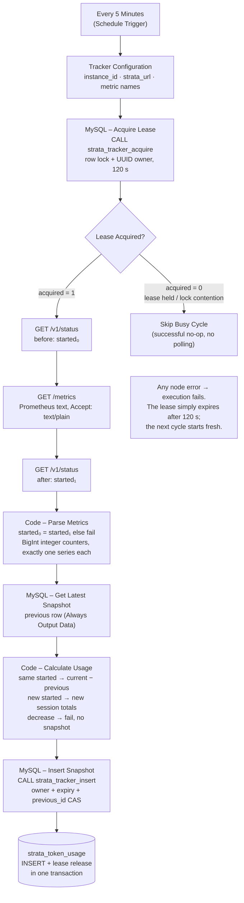

# Strata daily token usage tracker

An importable n8n workflow that tracks daily token usage of a Strata inference server. Every five minutes it reads the server's Prometheus counters, compares them with the previous snapshot, and writes one MySQL row per successful cycle — including idle cycles — so daily input/output token totals can be reported per tracked instance. It uses native Schedule, Edit Fields, HTTP Request, If, MySQL and Code nodes. No application server, container, external scheduler, or `api_monitor` is required.

`workflow.json` contains no secrets. It stores only credential *references* (name and ID), so after importing on another n8n instance you must create your own credentials and select them in the nodes — see [Credentials](#credentials).

## Requirements and installation

- Target n8n **2.44.5**. Node parameters were checked against this release's source: MySQL 2.5, HTTP Request 4.2, Schedule Trigger 1.3, Edit Fields 3.4, If 2.2, Code 2.
- MySQL **8.0+**, InnoDB, and connectivity from the n8n host to MySQL and to the Strata server's HTTP endpoint.
- A database administrator to install two tables and two small stored procedures. Procedures provide serialization across n8n connections/workers.

1. Create/select an application database, for example `strata_monitoring`, using `utf8mb4`. Install the schema using the MySQL client (it understands `DELIMITER`):

   ```sh
   mysql -h MYSQL_HOST -u SCHEMA_ADMIN -p strata_monitoring < schema.sql
   ```

   Use a SQL client that supports `DELIMITER`, such as the MySQL CLI or a compatible MySQL Workbench version. A script runner that splits procedure bodies at every semicolon will fail with error 1064.

   Installation also runs the two read-only reporting queries. Reinstall routines only while the workflow is inactive. The installing account becomes the routines' definer and must retain the underlying table privileges.

2. Provision a separate n8n database account through your normal password management process. Grant it these permissions, substituting its account and host:

   ```sql
   GRANT SELECT ON strata_monitoring.strata_token_usage TO 'n8n_tracker'@'N8N_HOST';
   GRANT EXECUTE ON PROCEDURE strata_monitoring.strata_tracker_acquire TO 'n8n_tracker'@'N8N_HOST';
   GRANT EXECUTE ON PROCEDURE strata_monitoring.strata_tracker_insert TO 'n8n_tracker'@'N8N_HOST';
   ```

   The runtime account does not need direct INSERT/UPDATE/DELETE privileges. All writers for an instance must use this workflow's routines. Do not manually alter snapshots while it is active.

3. In n8n, import `workflow.json` using **Import from File**. The export records `active: true` from the source workflow; verify the imported workflow's activation state before enabling polling. Create the two credentials described below and select them in the nodes before the first execution.

4. Open **Tracker Configuration** to set `instance_id`, `strata_url`, `input_metric` and `output_metric`. `strata_url` is the server's base URL (scheme, host, port) with no path or trailing slash; the workflow appends `/v1/status` and `/metrics` itself. Keep the same instance ID across executions and use a new ID for a genuinely different server/counter source. Do not include a trailing slash in the URL.

5. Keep workflow timezone **Asia/Hong_Kong** (or change it consistently — `recorded_at` is stored in the workflow's timezone, and reporting connections must match it). Each HTTP request has a 15-second timeout; workflow execution timeout is 90 seconds. Execute once manually, verify the baseline below, then publish/activate the workflow for automatic polling. n8n must remain running. Schedule changes take effect when the workflow is published/activated.

## Upgrade an existing database

Deactivate all tracker workflows sharing the database and back up the database. Run the one-time migration before reinstalling the routines:

```sh
mysql -h MYSQL_HOST -u SCHEMA_ADMIN -p strata_monitoring < migrations/001_usage_date.sql
mysql -h MYSQL_HOST -u SCHEMA_ADMIN -p strata_monitoring < schema.sql
```

The migration adds `usage_date` and backfills historical rows from the previous snapshot's `recorded_at`, separately for each instance in ID order. Each instance's first row uses its own date. Run it only on the old schema without `usage_date`; new installations use `schema.sql` directly. If a statement fails, keep the workflows inactive and inspect the database before retrying, since MySQL DDL is not transactional.

The updated insert procedure derives the date from the previous snapshot inside the existing transaction, so `workflow.json` and its procedure arguments stay compatible. Update dashboard queries to group/filter by `usage_date`, verify the rows, then reactivate polling.

## Credentials

The export references two n8n credentials by name and ID only; the secret values live in n8n's encrypted credential store and are not part of these files. After importing on any n8n instance, create equivalents and select them — a reference to a credential ID that doesn't exist there fails the node.

| Credential | Type | Used by | Contents |
| --- | --- | --- | --- |
| MySQL Credentials (api usage) | MySQL | Acquire Lease, Get Latest Snapshot, Insert Snapshot | Host, port, database, username, password of the runtime account (grants in step 2). Enable TLS if your database requires it. |
| Strata Endpoints Auth | HTTP Bearer Auth | Status Before Metrics, Strata Metrics, Status After Metrics | Bearer Token: the Strata API key, without a `Bearer ` prefix or quotes. |

To replace them in the nodes: open each node's **Credentials** section, choose **Create credential** (or pick an existing one) of the matching type, fill in the values, and save. The three MySQL nodes must all use the same MySQL credential, and all three HTTP nodes the same Bearer credential. The old references (`BmfH4Z5fAM6wGc9P`, `RAbWUP0vDl00ryE4`) are IDs from the source instance and are meaningless elsewhere.

## Counter names

The workflow defaults to `vllm:prompt_tokens_total` and `vllm:generation_tokens_total`, which the Strata server exposes through `GET /metrics` with `Accept: text/plain`. llama.cpp-style builds instead expose `llamacpp:prompt_tokens_total` and `llamacpp:tokens_predicted_total` via `GET /metrics/prometheus` (its prompt counter excludes prompt-cache reused tokens, so daily input totals are lower). Set `input_metric`/`output_metric` to the names your server actually returns — check with `curl -H 'Authorization: Bearer <key>' <strata_url>/metrics`. There is no automatic fallback: a missing selected counter fails the cycle without inserting a row.

Model names are never configured or hardcoded. Optional Prometheus labels are accepted. Exactly one series per selected metric must exist; multiple series fail as ambiguous rather than silently summing overlapping counters. Values must be unsigned decimal integer literals (no fractions, exponents, negative values, NaN or infinity). Optional integer Prometheus sample timestamps are ignored. Values up to `18446744073709551615` are preserved exactly; values beyond JavaScript's safe integer range travel as decimal strings. Query parameters prefix integer strings with `n`, then SQL removes the prefix before casting, to avoid n8n MySQL's automatic Number conversion. Generated `total_delta` overflow is rejected.

## Execution and serialization



The additional status request rejects a restart occurring during metric collection. The observation timestamp is generated once after the final status response, in Hong Kong wall time, and preserved through calculation and insertion. `started` must be a positive safe integer Unix timestamp in JSON, not a string.

`strata_tracker_acquire` briefly locks an instance's lease row in an InnoDB transaction and assigns a unique owner token for 120 seconds. A second execution encountering an active lease takes the skip branch before polling. Empty snapshot queries have **Always Output Data** enabled, producing one empty item for the initial baseline.

`strata_tracker_insert` locks that same row, checks the owner and expiry, confirms the previous snapshot ID is still current, inserts, and releases the lease in one transaction. This is safe across different pooled MySQL connections, manual executions, queue workers, and multiple copies of the workflow sharing this database and instance ID. A delayed execution cannot insert after another execution takes its expired lease. Independent deployments must share the lease table to coordinate.

The lease covers the polling/accounting critical section; expired executions can still be alive briefly, but they have no valid ownership and cannot commit. On errors the workflow stops. Its lease expires automatically after 120 seconds, before the next regular five-minute cycle. No cleanup workflow is needed. Database errors fail the execution; an already-owned lease or a database lock timeout/deadlock during acquisition is a successful skipped cycle. Keep **Query Batching = Single Query** on the MySQL nodes: acquire's CALL and SELECT must use the same session, and routines own their transactions. Do not add automatic insert retries or resume/retry from a failed intermediate node; start a fresh execution to acquire a new lease and observation.

## Accounting rules and reporting

| Observation | Stored deltas |
| --- | --- |
| No previous snapshot | Both zero; initial baseline excludes past usage |
| Same startup timestamp, increasing counters | Current minus previous, separately for input/output |
| Same startup timestamp, unchanged counters | Both zero; snapshot still inserted |
| Changed startup timestamp | Current input/output totals from the new session |
| Same startup timestamp, either counter decreases | Execution fails; no snapshot |

`schema.sql` includes daily totals and today's totals for `strata-p40`. Change the filter if you change the instance ID. Run `SET SESSION time_zone = '+08:00';` in **each reporting connection**, including dashboards, before using `CURRENT_DATE()`. `recorded_at` is `DATETIME(3)` containing Hong Kong wall time; it is not a UTC timestamp and requires no conversion. Lease timestamps use `UTC_TIMESTAMP(3)` independently of connection timezone.

Each row stores `recorded_at` as the actual snapshot datetime and `usage_date` as the date of the **previous snapshot for the same instance**. The first baseline uses its own date. For example, a snapshot at `2026-10-23 00:00:02` following `2026-10-22 23:55:02` has `usage_date = 2026-10-22`. Daily reports group and filter by `usage_date`. This rule also applies after restarts and delayed polls; the whole interval belongs to its starting day. This is sampling-based daily reporting; it cannot split an interval precisely at midnight. A failed cycle catches up on the next successful poll if the same Strata process is still running. On restart, usage between the last old-process snapshot and its shutdown is unrecoverable; only the new session's available counters can be counted. Entire sessions between polls are also unrecoverable. A model switch resetting counters without changing `started` will trigger the inconsistency check and needs investigation; use a new instance ID only when deliberately starting a new baseline.

## Verification

After the first manual execution, query:

```sql
SELECT id, recorded_at, usage_date, instance_id, server_started_at,
       input_total, output_total, input_delta, output_delta, total_delta
FROM strata_token_usage
WHERE instance_id = 'strata-p40'
ORDER BY id DESC LIMIT 10;
```

The first row must have zero deltas. Generate an ordinary inference request, then execute a fresh cycle: totals must increase and the deltas must equal their differences. A subsequent idle cycle must insert another row with zero deltas. Check n8n's execution history after publishing to confirm five-minute scheduling.

Dependency-free offline tests run the actual Code node bodies and inspect workflow topology/configuration:

```sh
node test.js
```

Optional SQL integration tests use a disposable MySQL **test server** and a root account accessible without a password through its local socket. They create and drop a uniquely named test database, never the application database:

```sh
STRATA_TEST_MYSQL=/path/to/mysql \
STRATA_TEST_SOCKET=/path/to/test/mysql.sock node test.js
```

Tests cover baseline, increases, unchanged counters, restart, either counter decreasing, malformed/missing metrics, invalid status, large integer precision, consecutive cycles, stale baselines, lease expiry, failed SQL rollback, eight simultaneous acquisitions, row-lock timeout skipping, midnight usage dates, per-instance date baselines, and historical migration. For deployment verification, temporarily point a copy at an unreachable Strata URL with a distinct test instance: the HTTP node must fail with no inserted row. Test an invalid MySQL connection similarly. Keep the production instance's configuration intact.

Usage-date validation: all 30 offline/SQL integration checks passed against a disposable MySQL 8.0.28 server, including migration backfill. No production database was changed.

Historical validation before the usage-date change: the unmodified export imported successfully through n8n 2.44.5’s CLI. All 27 offline/SQL integration checks passed against MySQL 8.4.11. A temporary test copy, using an Execute Workflow Trigger for CLI execution and the live server’s `vllm:` names, completed two live polling cycles into a disposable database with correctly reconciled deltas. Missing-metric, unreachable-Strata and unavailable-MySQL executions failed with no insertion. No production database was provisioned or schedule activated. Import through your UI and a manual run using your selected MySQL credential remain deployment verification steps.

## Troubleshooting

- **401/403:** select the Bearer Auth credential on every HTTP node and verify its token value.
- **Missing required Strata counter:** compare the configured metric names with what your server returns at `/metrics` (see Counter names). Never substitute zero. Metrics must be available through Strata without enabling `api_monitor`.
- **Invalid status / restarted while sampling:** inspect `/v1/status`; the next successful cycle can establish/count the new session.
- **Timeout / connection refused / MySQL unavailable:** check routing from the n8n host, port, firewall, TLS, and credentials. HTTP failures stop before querying/inserting snapshots.
- **Counter inconsistency:** inspect Strata process, counter resets and model reload behavior. The stored baseline is retained. Do not edit it to hide an unexplained decrease.
- **Skipped busy cycle:** normal when executions overlap. For diagnosis an administrator can inspect `SELECT * FROM strata_tracker_leases;`. Wait for expiry following a failed execution; do not delete a live lease.
- **Lease expired / previous snapshot changed:** insertion was fenced out. Run a fresh cycle. Investigate slow execution, paused workers, or writers bypassing the routines.
- **Permission/routine errors:** install the schema in the credential's database and check EXECUTE grants and definer privileges. Installers need CREATE TABLE, CREATE ROUTINE, ALTER ROUTINE and appropriate table permissions.
- **No first snapshot:** verify Get Latest Snapshot retains **Always Output Data**, then inspect the actual failed node's error. Error continuation and fabricated zero fallbacks are disabled.
- **Wrong reporting date:** use the Hong Kong workflow timezone and set the reporting session to `+08:00`; do not convert the already-local `recorded_at` values again.

Parameter references: [n8n MySQL query parameters](https://docs.n8n.io/integrations/builtin/app-nodes/n8n-nodes-base.mysql/), [target MySQL implementation](https://github.com/n8n-io/n8n/blob/n8n%402.44.5/packages/nodes-base/nodes/MySql/v2/actions/database/executeQuery.operation.ts), [target HTTP Request parameters](https://github.com/n8n-io/n8n/blob/n8n%402.44.5/packages/nodes-base/nodes/HttpRequest/V3/Description.ts).
